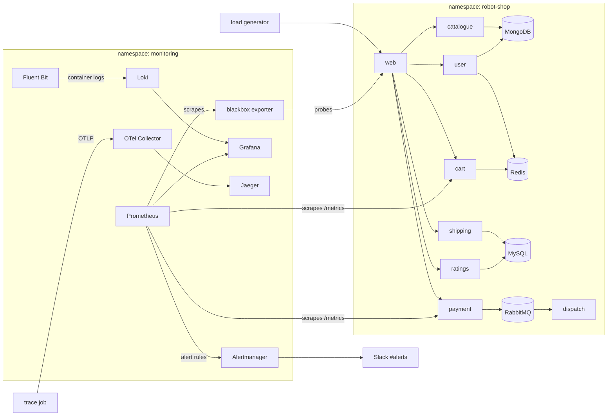

# Capstone 2: Production Observability & Reliability (Stan's Robot Shop on EKS)

This project builds full-stack observability, automated alerting, and incident management around [Stan's Robot Shop](https://github.com/instana/robot-shop), running on the AWS EKS cluster established in **Capstone 1**. The architecture is hardened with integrated metrics, container logs, distributed tracing, strict Service Level Objectives (SLOs) routed to Slack, documented runbooks, and a validated incident recovery drill.

---

## Table of Contents

- [Origin & Custom Modifications](#origin--custom-modifications)
- [System Architecture](#system-architecture)
- [Repository Layout](#repository-layout)
- [Deployment & Bootstrap Guide](#deployment--bootstrap-guide)
- [Step-by-Step Implementation & Validation](#step-by-step-implementation--validation)
- [Known Technical Constraints](#known-technical-constraints)
- [Teardown Instructions](#teardown-instructions)

---

## Origin & Custom Modifications

While the foundational logging, tracing, monitoring, and alerting templates were sourced from an approved cohort starter kit, the entire integration, configuration, and validation workflow has been specifically adapted:

- **Helm Chart Cleanup:** Stripped out all proprietary Instana agent telemetry and End-User Monitoring (EUM) parameters, since no Instana collector exists in the target cluster.
- **Storage Adaptation:** Migrated the Redis StatefulSet from persistent volumes to an `emptyDir` strategy, bypassing missing EBS CSI driver bindings in the default cluster configuration.
- **Dashboard Re-Engineering:** Replaced the generic hardware metrics dashboard (CPU, memory, restarts) with a tailored view focused on request throughput, error rates, and latency.
- **Synthetic Probing & Scraping:** Configured a dedicated blackbox `Probe` alongside a custom `ServiceMonitor` for reliable telemetry collection.
- **Tracing Pipeline Config:** Added missing ConfigMaps required by the OpenTelemetry tracing verification pipeline.
- **Documentation & Incident Operations:** Authored custom SLO documentation, a production-grade runbook linked directly to alert rules, a blameless postmortem report, and executed a live failure drill with its own timing benchmarks.

---

## System Architecture



---

## Repository Layout

| Directory / File | Purpose |
|---|---|
| `K8s/helm/` | Customized Robot Shop Helm chart (Instana removed, Redis using `emptyDir`) |
| `K8s/load-deployment.yaml` | Continuous traffic simulation deployment (15 client threads) |
| `observability/monitoring/` | Prometheus blackbox `Probe` definitions and `ServiceMonitor` resources |
| `observability/dashboards/` | Grafana dashboard JSON, automation ConfigMap, and generation scripts |
| `observability/logging/` | Loki backend deployment, Fluent Bit DaemonSet, and datasource provisioning |
| `observability/tracing/` | Jaeger backend, OTel Collector, and test verification jobs |
| `observability/alerts/` | Custom Prometheus alert rule definitions and Alertmanager Slack integration |
| `RUNBOOK.md` | Actionable remediation guidelines mapped to active alerts |
| `docs/SLO.md` | Formal definition of SLIs, SLO targets, error budgets, and consumption policy |
| `docs/POSTMORTEM.md` | Blameless postmortem detailing the incident drill |

---

## Deployment & Bootstrap Guide

Assuming the underlying EKS infrastructure from Capstone 1 is active (`terraform apply`), configure the cluster context and run the installation steps:

```bash
aws eks update-kubeconfig --name david-capstone-cluster --region eu-west-1

helm repo add prometheus-community https://prometheus-community.github.io/helm-charts
helm repo update
helm install prometheus prometheus-community/kube-prometheus-stack -n monitoring --create-namespace
helm install blackbox prometheus-community/prometheus-blackbox-exporter -n monitoring

helm install robot-shop K8s/helm -n robot-shop --create-namespace
kubectl apply -n robot-shop -f K8s/load-deployment.yaml

kubectl apply -f observability/logging/
kubectl apply -f observability/monitoring/probe-and-scrape.yaml
kubectl apply -f observability/dashboards/dashboard-configmap.yaml
kubectl apply -f observability/alerts/robot-shop-slo-rules.yaml
kubectl apply -f observability/tracing/jaeger.yaml -f observability/tracing/otel-collector.yaml
kubectl apply -f observability/tracing/trace-script-configmap.yaml -f observability/tracing/trace-job.yaml
```

> **Note:** The Prometheus release must be named `prometheus` inside the `monitoring` namespace so that alert rules match annotations and Loki links properly.

---

## Step-by-Step Implementation & Validation

### 1. Workload Deployment

The application deploys into the `robot-shop` namespace, running 12 core microservices alongside four data backends (MongoDB, MySQL, Redis, and RabbitMQ) and an active load generator with 15 concurrent clients. All pods transition to a healthy `Running` status.

### 2. Metrics & Dashboards

Because the application components lack native Prometheus instrumentation (aside from isolated business counters like `items_added` or `sold_count_total`), external blackbox probes evaluate web endpoints every 15 seconds:

- `probe_success`
- `probe_http_status_code`
- `probe_duration_seconds`

Dashboards are maintained as code and automatically provisioned via sidecar-loaded ConfigMaps.

### 3. Centralized Logging

A Fluent Bit DaemonSet captures node container logs and forwards them to Loki. Logs can be queried in Grafana Explore using structured labels:

```logql
# Service filtering
{service="payment"}

# Error parsing
{service="payment"} |~ "(?i)error"
```

> **Baseline observation:** Normal background noise from the load generator produces frequent non-blocking exceptions, so log counts are excluded from strict SLI calculations.

### 4. Distributed Tracing

Although the microservices are not natively instrumented for tracing, a synthetic verification job validates the telemetry path. It injects an OpenTelemetry trace (spanning `web`, `catalogue`, `cart`, and `payment`) via OTLP into the collector, confirming end-to-end ingestion in Jaeger.

- **Trace ID:** `901a6b371e1642259f2686d73996e0f9`

### 5. SLOs, Error Budgets & Alerting

Governed by the formal definitions in [`docs/SLO.md`](docs/SLO.md):

| Service | SLI | SLO | 30-Day Error Budget |
|---|---|---|---|
| **Payment Service** | At least one active, ready payment pod | 99.5% availability | 216 minutes |
| **Web Gateway** | Successful probe responses | 99.0% availability | 432 minutes |

Alertmanager rules fire notifications to a dedicated Slack webhook channel, embedding direct links back to the remediation runbook ([`RUNBOOK.md`](RUNBOOK.md)).

### 6. Incident Drill & Recovery

A controlled failure drill was executed by scaling the `payment` deployment down to zero replicas. Timeline:

| Event | Time |
|---|---|
| Fault injected | 15:39:35 |
| Mitigation initiated | 15:40:48 |
| Slack alert received | ~15:41 |
| Full recovery verified | 15:46:28 |

**Total outage duration:** 6 minutes 53 seconds (~3.2% of the monthly payment error budget).

The complete analysis is in [`docs/POSTMORTEM.md`](docs/POSTMORTEM.md).

---

## Known Technical Constraints

- **Volatile Storage:** Loki, Redis, and Prometheus use ephemeral `emptyDir` volumes. Pod restarts cause telemetry data loss and prevent long-term historical SLO evaluation.
- **Proxy Telemetry:** Service health metrics rely on blackbox probing and pod readiness state rather than direct application request instrumentation.
- **Single-Replica Topology:** All workloads run as single replicas, so service disruptions during node or pod scheduling changes are immediately visible.
- **Public Ingress Exposure:** The web frontend provisions an active AWS load balancer. The Helm release must be removed before infrastructure deletion.

---

## Teardown Instructions

To clean up resources prior to infrastructure destruction:

```bash
helm uninstall robot-shop -n robot-shop
# Proceed with terraform destroy within the Capstone 1 infrastructure workspace
```
